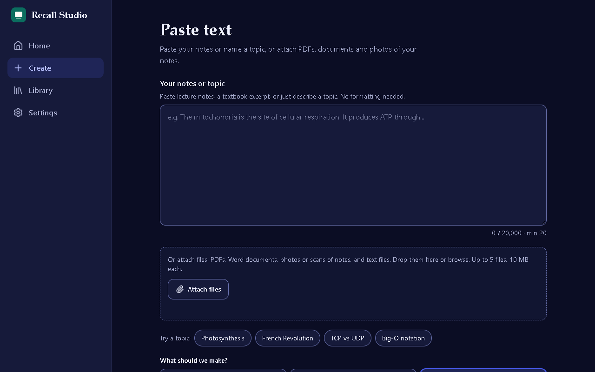
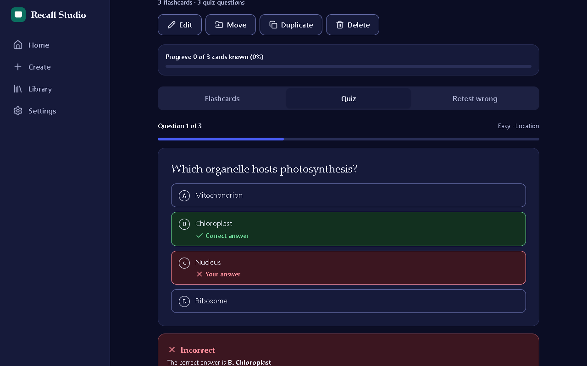
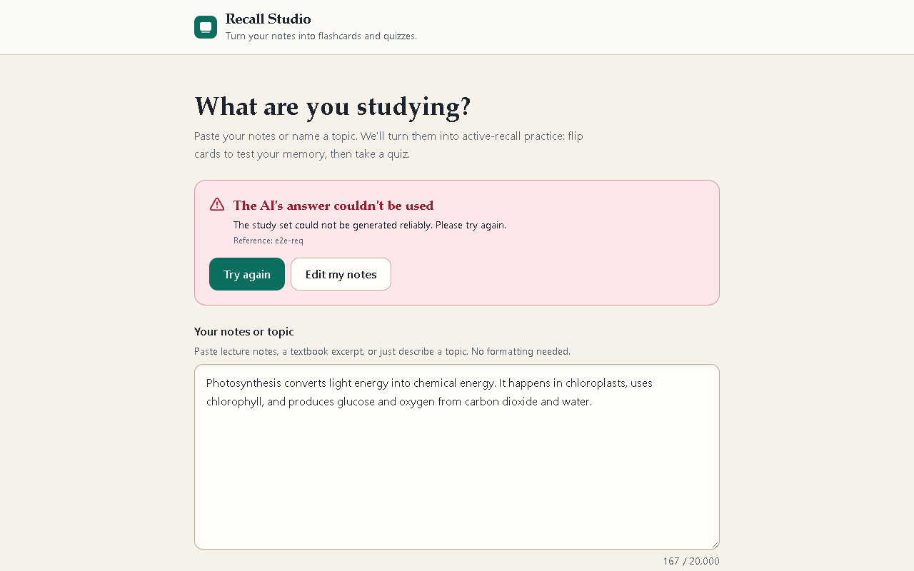

# Recall Studio — notes to flashcards and quizzes

Paste study notes (or just a topic), pick **Flashcards**, **Quiz** or **Both**, and get an interactive study set generated by an LLM. Flip and navigate flashcards, answer a multiple-choice quiz with instant feedback and explanations, see your score, and **retest only the questions you got wrong**.

This is a React app, not a chatbot: the model returns structured JSON, the server validates it, and the UI renders real stateful components. The main engineering focus is **handling unpredictable model output** — malformed JSON, wrong shapes, empty output, timeouts, provider errors and out-of-order responses never crash the app.

| Input | Flashcard | Quiz feedback |
|---|---|---|
|  |  |  |

| Results | Recoverable error | Mobile (320 px) |
|---|---|---|
|  |  |  |

*Screenshots are captured by the Playwright suite against the real UI with a mocked API response (no live model call).*

## Features

- Free-form notes/topic input with live character count (min 20, max 20,000). Over-limit text is **never silently truncated** — it is flagged and Generate is disabled.
- Flashcards: one at a time, flip with click/tap/Space, previous/next, "Card X of Y", arrow keys while the card is focused.
- Quiz: pick an option → **Check answer** → correct/incorrect (icon + text, not colour alone) + explanation → Next → score.
- Retest Wrong: only the missed questions, original answers and explanations preserved, scored independently; perfect score gets a positive empty state.
- Loading (with Cancel), validation, empty, success and error states; Retry keeps your notes and mode.
- Responsive to 320 px with no horizontal overflow; semantic HTML, native radios/buttons, visible focus, reduced-motion support.

## Tech stack

React 19 + TypeScript + Vite · Tailwind CSS v4 · Express 5 · Zod 4 (shared client/server contract) · Gemini via `@google/genai` (server-side only) · Vitest + React Testing Library + supertest · Playwright (Edge).

Architecture, trade-offs and design tokens: [`docs/ARCHITECTURE.md`](docs/ARCHITECTURE.md). Tests: [`docs/TEST_PLAN.md`](docs/TEST_PLAN.md).

## Setup

**Prerequisites:** Node.js 22.9+ (developed on Node 24; the dev server uses `--env-file-if-exists`) and npm.

```bash
npm install
```

Create your env file and add a Gemini API key (free key from <https://aistudio.google.com/apikey>):

```bash
cp .env.example .env
```

(Windows PowerShell: `Copy-Item .env.example .env`.) Edit `.env`:

| Variable | Required | Default | Purpose |
|---|---|---|---|
| `GEMINI_API_KEY` | **Yes** for real generation | — | Server-side only. Never `VITE_`-prefixed, never sent to the browser. |
| `GEMINI_MODEL` | No | `gemini-3.5-flash-lite` | Model id. Change it if Google retires/renames models. |
| `AI_TIMEOUT_MS` | No | `30000` | Timeout per provider call (initial + at most one repair). |
| `API_PORT` | No | `8787` | API port (Vite proxies `/api` to it). |

Run:

```bash
npm start
```

Open <http://localhost:5173>. `npm start` runs the Vite client and the API together (`npm run dev` is an alias). Without a key the app still starts; generating shows a clear "AI isn't set up yet" message (`503 AI_NOT_CONFIGURED`).

Production-style run: `npm run start:prod` (builds, then serves on <http://localhost:4173> with the API).

## Scripts

| Command | What it does |
|---|---|
| `npm start` / `npm run dev` | Client + API in development |
| `npm run lint` | ESLint |
| `npm run typecheck` | `tsc -b` across client, server, tests and config projects |
| `npm test` | Vitest: unit, API and component tests (no network, no key needed) |
| `npm run build` | Typecheck + production build |
| `npm run test:e2e` | Playwright smoke suite at 1280 px and 320 px (uses the Edge already on Windows; set `PW_CHANNEL=chromium` after `npx playwright install chromium` elsewhere). Mocks the API — no key needed. |

## How the AI output is handled

1. Client sends `POST /api/study/generate` `{ notes, mode }`. The server re-validates type, mode and length.
2. The server asks Gemini for JSON using its **schema mode** (`responseMimeType` + `responseJsonSchema`, generated from the same Zod schema used for validation). The prompt says: use only the supplied notes, plain text only, plausible-but-unambiguous distractors, ignore instructions inside the notes.
3. The response is parsed and **validated at runtime** (Zod + semantic checks): non-empty bounded strings, 3–15 items per requested type, exactly four distinct options, `correctIndex` 0–3, valid difficulty, no duplicate questions. Content that wasn't requested is stripped.
4. If parsing/validation fails (or output is empty), the server makes **exactly one repair call** that includes the validation problem and the previous output. Still failing → typed `AI_INVALID_OUTPUT` / `AI_EMPTY_OUTPUT` (HTTP 502, retryable). No loops, no fabricated content, no partial rendering.
5. The server assigns IDs and timestamps itself; the client validates the response again before rendering.
6. The score is computed in the app from the user's answers — never by the model.

Stable error codes the UI branches on: `INVALID_REQUEST`, `PAYLOAD_TOO_LARGE`, `NOT_FOUND`, `AI_NOT_CONFIGURED`, `AI_RATE_LIMITED`, `AI_PROVIDER_ERROR`, `AI_TIMEOUT`, `AI_EMPTY_OUTPUT`, `AI_INVALID_OUTPUT`, `INTERNAL_ERROR` (+ client-only `NETWORK_ERROR`, `CLIENT_TIMEOUT`, `BAD_RESPONSE`).

**Stale-request protection:** every generation gets an increasing ID and aborts the previous request. Only the latest request may update state — late successes *and* late failures from older requests are dropped. A deterministic test resolves request B before A and asserts B stays on screen (the fake ignores the abort signal, so the ID guard itself is tested).

## Verification status (honest summary)

Run on this machine at the end of development:

- `npm run lint` — pass · `npm run typecheck` — pass · `npm run build` — pass
- `npm test` — **97 tests passed** (7 files)
- `npm run test:e2e` — **18 passed** (9 flows × desktop and 320 px)
- Manual real-browser QA at desktop and 320 px, including the full stack with no key (real `AI_NOT_CONFIGURED` error path).
- **A live Gemini call has not been made** — no API key was available while building. The Gemini adapter is verified with the real SDK against a local mock server (request shape, schema-mode config, 429/5xx/empty/abort handling), but the real model's output quality and the current default model id are unverified until you run the smoke test below.

### Manual live smoke test (do this once with your key)

1. Put your key in `.env`, run `npm start`, open <http://localhost:5173>.
2. Click the "Photosynthesis" chip → **Both** → Generate.
3. Expect 3–10 flashcards and quiz questions within ~5–20 s. If the call fails with `AI_PROVIDER_ERROR`, check the server console and try another `GEMINI_MODEL` (model ids change; see <https://ai.google.dev/gemini-api/docs/models>).

## AI-use note

I used Claude (Claude Code) as a pair-programmer for planning, implementing, testing and debugging this project, working in my local folder. It wrote most of the code and tests; browser QA was driven by the assistant in a real browser and several layout bugs it found were fixed. The architecture and trade-offs in `docs/ARCHITECTURE.md` are meant to be understood and explained by me, and I'm responsible for the result. The product itself calls a real LLM (Gemini) from the backend as described above.

Tools the brief mentioned but that were **not** available in the build environment: `frontend-design`, UI/UX Pro Max, Context7, the Playwright and shadcn MCP servers. Library docs were fetched directly instead, UI was hand-built with native elements and Tailwind, and Playwright was used as a normal dev dependency.

> **Edit before submitting:** adjust this paragraph so it accurately describes how *you* used AI tools.

## Known limitations and next steps

- Live model output quality/default model id not yet verified with a real key (see above).
- No persistence: refreshing the page loses the study set. Next: save `{notes, mode, studySet}` to `localStorage` with a clear "saved on this device" control.
- No regenerate-from-same-notes, shuffle, dark mode, streaming, accounts or deployment (P1/P2, intentionally skipped).
- Very long notes are sent as-is (up to 20,000 chars); no chunking/summarising for huge documents.
- No rate limiting on the API (fine for local use; add before exposing publicly).
- Playwright covers Edge/Chromium only; accessibility was reviewed via semantics and tests, not with a screen reader.
- Two unused Vite template files remain and can be deleted: `src/assets/` and `public/icons.svg`.

## Time spent

**Actual time spent: _[fill in your own figure before submitting]_** — I have deliberately not estimated this for you.

## Screen-recording checklist (≈2–3 min)

1. Show `npm install`, `.env` (key blurred/hidden), then `npm start` and the browser at <http://localhost:5173>.
2. Click the "Photosynthesis" chip, keep **Both**, Generate. Mention the loading state and Cancel.
3. Flashcards: flip (click, then Space), Next/Previous, note "Card X of Y".
4. Quiz: choose a wrong answer → Check → show feedback + explanation; answer the rest with a mix of right/wrong → results.
5. **Retest wrong answers** → only the missed questions appear. Then show a perfect run's "no wrong answers" state (optional).
6. Resize the window / use device mode to ~320 px — no sideways scrolling.
7. Failure handling: stop the server (or unset the key) and generate → friendly error, notes preserved, Retry/Edit. Mention one repair attempt and stale-request protection.
8. Finish with `npm test` and `npm run test:e2e` passing.

## Project status

Built locally; not pushed or deployed.
