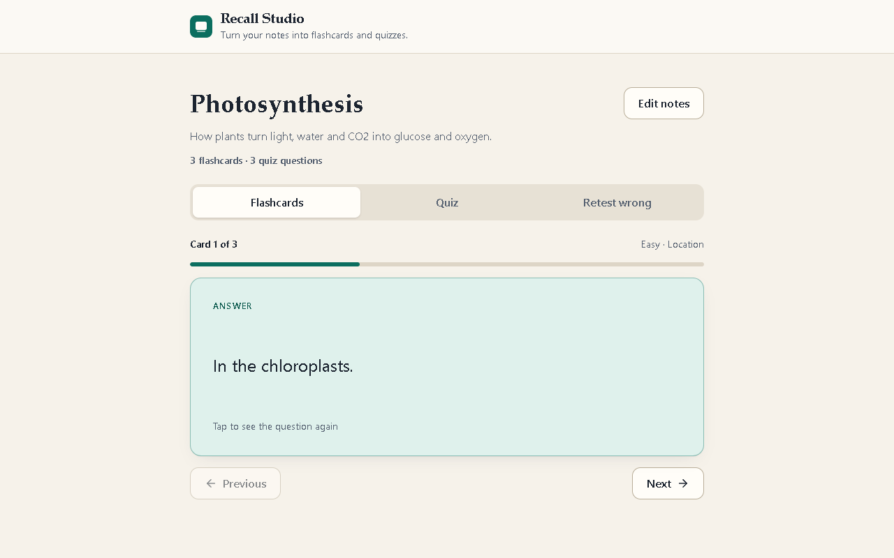
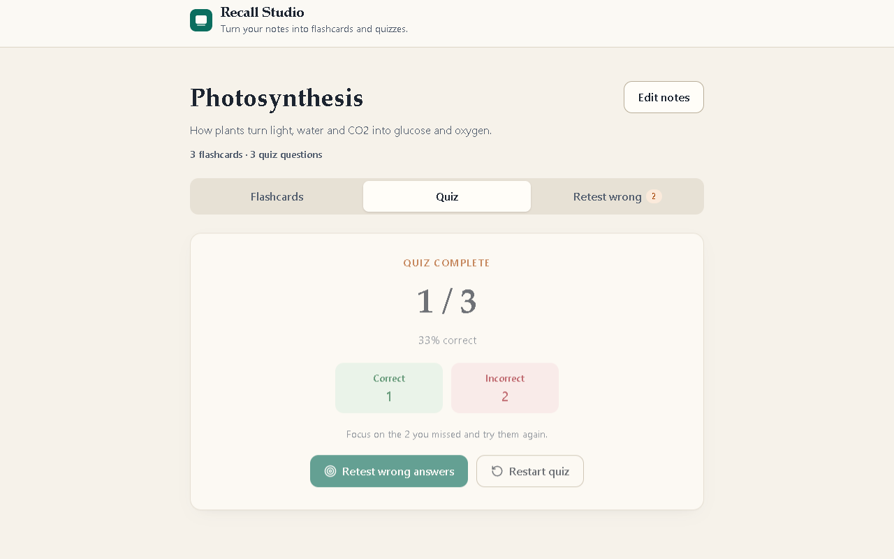
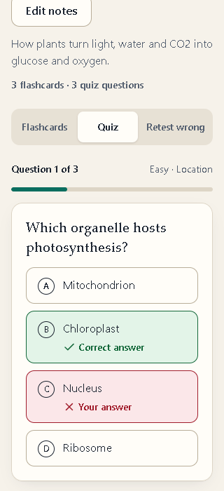
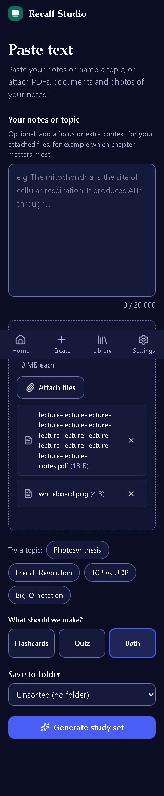
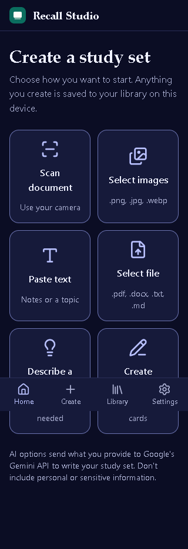
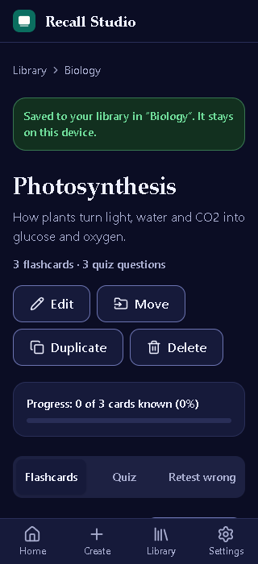
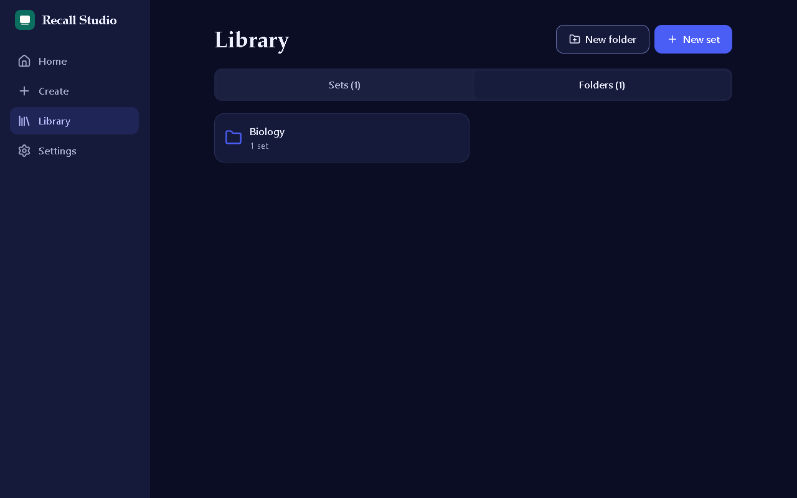

# Recall Studio — notes to flashcards and quizzes

Paste study notes (or just a topic), pick **Flashcards**, **Quiz** or **Both**, and get an interactive study set generated by an LLM. Flip and navigate flashcards, answer a multiple-choice quiz with instant feedback and explanations, see your score, and **retest only the questions you got wrong**.

This is a React app, not a chatbot: the model returns structured JSON, the server validates it, and the UI renders real stateful components. The main engineering focus is **handling unpredictable model output** — malformed JSON, wrong shapes, empty output, timeouts, provider errors and out-of-order responses never crash the app.

| Input | Flashcard | Quiz feedback |
|---|---|---|
|  |  |  |

| Results | Recoverable error | Mobile (320 px) |
|---|---|---|
|  |  |  |

**File attachments (320 px):** 

| Create menu | Saved set | Library folders |
|---|---|---|
|  |  |  |

*Screenshots are captured by the Playwright suite against the real UI with a mocked API response (no live model call). Regenerate with `npm run test:e2e:screenshots`.*

## Features

**App structure (a study-app layout: sidebar on desktop, bottom tab bar on phones)**

- **Home:** study streak, set and known-card counts, quick-create shortcuts, "Continue studying" and your folders.
- **Create menu:** Scan document (camera on phones), Select images, Paste text, Select file, Describe a topic, and Create manually (no AI, works offline).
- **Library:** all your sets with search, folder filter and sort; a Folders tab for one folder per subject (Biology, Spanish...) with colours. Sets can be moved, duplicated, renamed, edited and deleted (with confirmation). Deleting a folder either keeps its sets (moved to Unsorted) or deletes them too, your choice.
- **Study tools:** star cards, mark "I know it" / "Still learning", shuffle, study only starred or not-yet-known cards, per-set progress %, best quiz score, daily streak.
- **Card editor:** write or edit cards, and bulk-import pasted lines (`term - definition`, tab-separated, `::`). Editing keeps progress on untouched cards. "Make a quiz from these cards" adds an AI quiz to a cards-only set.
- **Settings:** dark / light / follow-device theme, export and import a JSON backup (merge or replace), delete all data.
- Everything you create is saved **in this browser only** (`localStorage`); there are no accounts or servers storing your sets.

**Generation, studying and quality**

- Free-form notes/topic input with live character count (min 20, max 20,000). Over-limit text is **never silently truncated** — it is flagged and Generate is disabled.
- **File uploads as notes:** attach PDFs, scans or photos of handwritten notes (PNG/JPG/WEBP), Word documents (`.docx`, legacy `.doc`), and `.txt`/`.md` files, alone or together with typed notes. Up to 5 files, 10 MB each, 12 MB total. Gemini reads PDFs and images natively (including scanned pages and handwriting), so there is no separate OCR step.
- Flashcards: one at a time, flip with click/tap/Space, previous/next, "Card X of Y", arrow keys while the card is focused.
- Quiz: pick an option → **Check answer** → correct/incorrect (icon + text, not colour alone) + explanation → Next → score.
- Retest Wrong: only the missed questions, original answers and explanations preserved, scored independently; perfect score gets a positive empty state.
- Loading (with Cancel), validation, empty, success and error states; Retry keeps your notes and mode.
- Responsive to 320 px with no horizontal overflow; semantic HTML, native radios/buttons, visible focus, reduced-motion support.

## Tech stack

React 19 + TypeScript + Vite · React Router 8 · Tailwind CSS v4 · Express 5 · Zod 4 (shared client/server contract) · Gemini via `@google/genai` (server-side only) · Vitest + React Testing Library + supertest · Playwright (Edge).

Architecture, trade-offs and design tokens: [`docs/ARCHITECTURE.md`](docs/ARCHITECTURE.md). Tests: [`docs/TEST_PLAN.md`](docs/TEST_PLAN.md).

## Setup

**Prerequisites:** Node.js 22.9+ (developed on Node 24; the dev server uses `--env-file-if-exists`) and npm.

```bash
npm install
```

Create your env file and add a Gemini API key (free key from <https://aistudio.google.com/apikey>):

```bash
cp .env.example .env
```

(Windows PowerShell: `Copy-Item .env.example .env`.) Edit `.env`:

| Variable | Required | Default | Purpose |
|---|---|---|---|
| `GEMINI_API_KEY` | **Yes** for real generation | — | Server-side only. Never `VITE_`-prefixed, never sent to the browser. |
| `GEMINI_MODEL` | No | `gemini-3.5-flash` | Main model id. Leave unset unless Google retires/renames it. Check what your key can use: `curl -H "x-goog-api-key: KEY" https://generativelanguage.googleapis.com/v1beta/models`. A model that is listed there can still answer 404 for your key, so test it. |
| `GEMINI_FALLBACK_MODEL` | No | `gemini-3.5-flash-lite` | Second model, tried only when the main one keeps failing from overload (503/5xx), a network failure or an exhausted quota (429). Never used for a bad key or request. `none` turns it off. |
| `AI_TIMEOUT_MS` | No | `45000` | Time limit for one model call, retries included (initial + at most one repair, so a request can take up to twice this; double again with files). The browser waits longer than that, so the server's own error always arrives first. |
| `API_PORT` | No | `8787` | API port (Vite proxies `/api` to it). |

Run:

```bash
npm start
```

Open <http://localhost:5173>. `npm start` runs the Vite client and the API together (`npm run dev` is an alias). Without a key the app still starts; generating shows a clear "AI isn't set up yet" message (`503 AI_NOT_CONFIGURED`).

Production-style run: `npm run start:prod` (builds, then serves on <http://localhost:4173> with the API).

## Scripts

| Command | What it does |
|---|---|
| `npm start` / `npm run dev` | Client + API in development |
| `npm run lint` | ESLint |
| `npm run typecheck` | `tsc -b` across client, server, tests and config projects |
| `npm test` | Vitest: unit, API and component tests (no network, no key needed) |
| `npm run build` | Typecheck + production build |
| `npm run test:e2e` | Playwright smoke suite at 1280 px and 320 px (uses the Edge already on Windows; set `PW_CHANNEL=chromium` after `npx playwright install chromium` elsewhere). Mocks the API — no key needed. |

## How the AI output is handled

1. Client sends `POST /api/study/generate` — JSON `{ notes, mode }` for text only, or `multipart/form-data` (`notes`, `mode`, `files`) when files are attached. The server re-validates type, mode, length and files.
2. The server asks Gemini for JSON using its **schema mode** (`responseMimeType` + `responseJsonSchema`, generated from the same Zod schema used for validation). The prompt says: use only the supplied notes, plain text only, plausible-but-unambiguous distractors, ignore instructions inside the notes.
3. The response is parsed and **validated at runtime** (Zod + semantic checks): non-empty bounded strings, 3–15 items per requested type, exactly four distinct options, `correctIndex` 0–3, valid difficulty, no duplicate questions. Content that wasn't requested is stripped.
4. If parsing/validation fails (or output is empty), the server makes **exactly one repair call** that includes the validation problem and the previous output. Still failing → typed `AI_INVALID_OUTPUT` / `AI_EMPTY_OUTPUT` (HTTP 502, retryable). No loops, no fabricated content, no partial rendering.
5. The server assigns IDs and timestamps itself; the client validates the response again before rendering.
6. The score is computed in the app from the user's answers — never by the model.

### How uploaded files are understood

- The server decides a file's type from its **bytes** (magic numbers), never from the browser's MIME type or the file name. A PNG renamed `.pdf` is treated as a PNG; a ZIP that isn't a Word file is rejected.
- **PDF, PNG, JPEG, WEBP** (and legacy `.doc`) are sent to Gemini inline as base64 parts next to the prompt. Gemini does the OCR/vision work, so scanned PDFs and photos of handwriting work without a separate OCR library.
- **DOCX** is converted to plain text on the server with `mammoth`; **TXT/MD** are read as strict UTF-8. Extracted text is capped at 60,000 characters and is **rejected, not silently clipped**, above that.
- Files stay in memory (never written to disk) and are re-sent on the single repair call so it sees the same source.
- **Privacy:** uploaded files and typed notes are sent to Google's Gemini API to generate the study set. This app does not store them or log their names, contents or extracted text (logs contain counts only). Do not upload anything you would not send to that service.
- File errors are typed and non-retryable: `UNSUPPORTED_FILE_TYPE` (415), `FILE_TOO_LARGE` (413), `TOO_MANY_FILES` (400), `FILE_UNREADABLE` (422: corrupt, empty, password-protected, or rejected by the model).

Stable error codes the UI branches on: `INVALID_REQUEST`, `PAYLOAD_TOO_LARGE`, `NOT_FOUND`, `UNSUPPORTED_FILE_TYPE`, `FILE_TOO_LARGE`, `TOO_MANY_FILES`, `FILE_UNREADABLE`, `AI_NOT_CONFIGURED`, `AI_CONFIG_ERROR` (key/model rejected, non-retryable), `AI_RATE_LIMITED`, `AI_PROVIDER_ERROR`, `AI_TIMEOUT`, `AI_EMPTY_OUTPUT`, `AI_INVALID_OUTPUT`, `INTERNAL_ERROR` (+ client-only `NETWORK_ERROR`, `CLIENT_TIMEOUT`, `BAD_RESPONSE`).

**Stale-request protection:** every generation gets an increasing ID and aborts the previous request. Only the latest request may update state — late successes *and* late failures from older requests are dropped. A deterministic test resolves request B before A and asserts B stays on screen (the fake ignores the abort signal, so the ID guard itself is tested).

## Verification status (honest summary)

Run on this machine at the end of development (last run: app shell, library and study tools included):

- `npm run lint` — pass · `npm run typecheck` — pass · `npm run build` — pass
- `npm test` — **253 tests passed** (12 files)
- `npm run test:e2e` — **34 passed** (17 flows × desktop and 320 px)
- Manual real-browser QA at desktop and 320 px, including the full stack with no key (real `AI_NOT_CONFIGURED` error path).
- **A live Gemini call has not been made** — no API key was available while building. The Gemini adapter is verified with the real SDK against a local mock server (request shape, schema-mode config, 429/5xx/empty/abort handling), but the real model's output quality and the current default model id are unverified until you run the smoke test below.

### Manual live smoke test (do this once with your key)

1. Put your key in `.env`, run `npm start`, open <http://localhost:5173>.
2. Click the "Photosynthesis" chip → **Both** → Generate.
3. Expect 3–10 flashcards and quiz questions within ~5–20 s.
4. If it fails, the server console logs the error code and upstream HTTP status (never the key or your notes). `AI_CONFIG_ERROR` (a 4xx from Gemini) means the key or model id was rejected, or Gemini refused the request schema — check `GEMINI_API_KEY` and try another `GEMINI_MODEL` (model ids change; see <https://ai.google.dev/gemini-api/docs/models>). `AI_PROVIDER_ERROR` is a 5xx/network problem. The server already retries it twice (0.7 s, then 1.5 s) and then tries `GEMINI_FALLBACK_MODEL`; each retry or switch is logged as a `[warn] gemini retry …` / `switching to fallback` line with the model and a safe reason such as `ApiError/UNAVAILABLE`. If users still see it, Gemini was down for both models, so wait a minute and retry.

## AI-use note

I used Claude (Claude Code) as a pair-programmer for planning, implementing, testing and debugging this project, working in my local folder. It wrote most of the code and tests; browser QA was driven by the assistant in a real browser and several layout bugs it found were fixed. The architecture and trade-offs in `docs/ARCHITECTURE.md` are meant to be understood and explained by me, and I'm responsible for the result. The product itself calls a real LLM (Gemini) from the backend as described above.

Tools the brief mentioned but that were **not** available in the build environment: `frontend-design`, UI/UX Pro Max, Context7, the Playwright and shadcn MCP servers. Library docs were fetched directly instead, UI was hand-built with native elements and Tailwind, and Playwright was used as a normal dev dependency.

> **Edit before submitting:** adjust this paragraph so it accurately describes how *you* used AI tools.

## Known limitations and next steps

- Live model output quality/default model id not yet verified with a real key (see above).
- **Your library lives only in this browser's `localStorage`:** no sync between devices, and clearing site data deletes it. Export a backup from Settings. Uploaded files are not stored, only the generated cards and quiz. A full or blocked store is detected and reported, and unreadable saved data is backed up (`recall-studio:library:corrupt-backup`) rather than discarded.
- Folders are one level deep (no sub-folders), and there is no drag-and-drop between folders: use Move on a set.
- Deliberately not built, because they need infrastructure beyond this scope: classes/sharing and accounts (need a backend and auth), podcast mode (needs text-to-speech), games and spaced-repetition scheduling.
- No regenerate-from-same-notes or streaming.
- **The file path has not been tested with a live key.** Inline file parts, the file-rejection mapping (a Gemini 400 with files attached becomes `FILE_UNREADABLE`), and legacy `.doc` pass-through are verified only against a local mock server. `.doc` support relies on Gemini's documentation and is the least certain format; if it fails, save the file as `.docx` or PDF. Encrypted PDFs, `.pptx`/`.xlsx`, and very large scans are not supported or not specially handled.
- DOCX text extraction has no zip-bomb guard beyond the 10 MB upload cap. Acceptable for a small deployment, but add one before real public traffic.
- Very long notes are sent as-is (up to 20,000 chars); no chunking/summarising for huge documents.
- Rate limiting is a simple in-memory per-IP cap on generate calls (10/min in production, `RATE_LIMIT_PER_MIN` to change). It resets on restart and is per instance: a cost guard, not real abuse protection. There are no accounts, so anyone with the URL can spend your Gemini quota up to that limit.
- Playwright covers Edge/Chromium only; accessibility was reviewed via semantics and tests, not with a screen reader.
- Two unused Vite template files remain and can be deleted: `src/assets/` and `public/icons.svg`.

## Deploying (Render)

One Node web service serves the built app and the API together, so there is no CORS and the Gemini key never reaches the browser.

1. Push the repo to GitHub, then in Render choose **New > Blueprint** and select it. `render.yaml` defines the service (build `npm ci --include=dev && npm run build`, start `npx tsx server/index.ts`, health check `/api/health`).
2. When prompted, set **`GEMINI_API_KEY`** in the Render dashboard. It is deliberately not in `render.yaml`.
3. Open the service URL. `/api/health` should return `{"ok":true}`; then generate a set to confirm the key works.

Notes: the free plan sleeps after idle time, so the first request can take about a minute. Library data stays in each visitor's own browser. To try the production setup locally: `npm run build`, then `npm run serve` and open <http://localhost:8787>.

## Installable app and Google Play

The site is an installable PWA (manifest, icons, offline app shell via `public/sw.js`). Open it on a phone and tap **Install app** (on Home, or in Settings → Install the app), or use the browser menu's **Add to Home Screen**. You can also wrap it as an Android app with PWABuilder and publish to Google Play. The full step-by-step guide, including what only you can do (developer account, signing key, privacy policy, store listing), is in [docs/PLAY_STORE.md](docs/PLAY_STORE.md). Store graphics are in `store-assets/` (regenerate with `node scripts/make-icons.mjs`).

## Time spent

**Actual time spent: _[fill in your own figure before submitting]_** — I have deliberately not estimated this for you.

## Screen-recording checklist (≈2–3 min)

1. Show `npm install`, `.env` (key blurred/hidden), then `npm start` and the browser at <http://localhost:5173>.
2. Tour the shell: Home → **Create** menu (point at the six options). Choose **Paste text**, click the "Photosynthesis" chip, pick "+ New folder…" and name it Biology, keep **Both**, Generate. Mention the loading state and Cancel. The set saves to the library automatically.
2b. Show **Library** → Folders → Biology, then reload the page to show everything persisted. Briefly show **Select file** with a PDF and **Settings** (theme, backup).
3. Flashcards: flip (click, then Space), Next/Previous, note "Card X of Y"; star a card, mark "I know it", try Shuffle and the Starred filter.
4. Quiz: choose a wrong answer → Check → show feedback + explanation; answer the rest with a mix of right/wrong → results.
5. **Retest wrong answers** → only the missed questions appear. Then show a perfect run's "no wrong answers" state (optional).
6. Resize the window / use device mode to ~320 px — no sideways scrolling.
7. Failure handling: stop the server (or unset the key) and generate → friendly error, notes preserved, Retry/Edit. Mention one repair attempt and stale-request protection.
8. Finish with `npm test` and `npm run test:e2e` passing.

## Project status

Pushed to a private GitHub repo. A Render Blueprint (`render.yaml`) is included; whether it is live depends on whether you have created the service.
